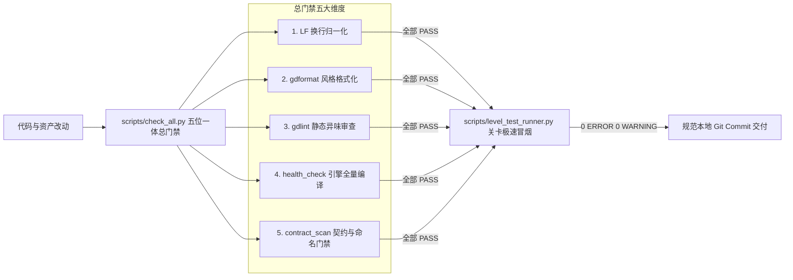

# ZMXYBHYH 全工程命名规范与契约白皮书 (Comprehensive Naming & Contract Standard)

> **版本**：v1.0.0 (Phase 8 固化版)  
> **生效范围**：`source/v6.5.0.0/` 活跃开发主工程全量代码、场景、资源与目录  
> **对标权威**：[Godot 4 GDScript Style Guide](https://docs.godotengine.org/en/stable/tutorials/scripting/gdscript/gdscript_styleguide.html) & [Godot Project Organization](https://docs.godotengine.org/en/stable/tutorials/best_practices/project_organization.html)

---

## 0. 核心宪章原则 (Core Tenets)

1. **单一真源原则 (Single Source of Truth)**：任何命名（文件、目录、节点、变量、函数、常量、字典键）必须有且仅有一个权威定义源。代码字面量、场景树引用与磁盘实体必须严格 100% 一致，严禁出现“看似同义、大小写不同”的伪匹配；
2. **跨平台大小写敏感铁律 (Case-Sensitivity Invariant)**：Windows 本地 NTFS 文件系统不区分大小写，但导出到 Linux/macOS/Android 或在 Git 跨平台检出时绝对区分大小写。**所有路径引用必须与磁盘实际字节大小写逐字精确对应**，杜绝任何大小写隐式断裂；
3. **规范前置于施工 (Constitution Before Construction)**：后续所有阶段（Phase 9 代码收尾、Phase 10 资产迁移等）必须严格遵循本规范。任何违背本规范的代码或文件变更，工程质量总门禁将坚决予以拦截；
4. **工具化原子落地 (Tool-Guaranteed Execution)**：涉及路径变更必须经由统一引擎 `scripts/rename_path.py` 执行两步式迁移与全盘协同更新，严禁人工裸改。

---

## 1. 目录结构命名规范 (Directory Naming)

### 1.1 核心规则
- **全小写下划线 (`snake_case`)**：工程内所有功能目录、分类目录与各级子目录，一律遵循纯小写下划线命名；
- **禁止格式**：严禁在目录名中使用 `PascalCase`、`camelCase`、空格、特殊符号或中文字符。

### 1.2 顶层目录职责与命名约定
| 顶层目录 | 目录命名规范 | 职责边界 | 演进状态 |
|:---|:---|:---|:---:|
| `source/v6.5.0.0/Scene/` | 业务子目录统一 `snake_case` | 存放游戏场景树 (`.tscn`) 与预制体 | 渐进收敛中 |
| `source/v6.5.0.0/Script/` | 业务子目录统一 `snake_case` | 存放 GDScript 业务逻辑脚本 (`.gd`) | 渐进收敛中 |
| `source/v6.5.0.0/Art/` | 业务子目录统一 `snake_case` | 存放美术贴图、精灵帧与图集（除机器导出白名单外） | 渐进收敛中 |
| `source/v6.5.0.0/Music/` | 业务子目录统一 `snake_case` | 存放背景音乐与音效文件容器 (`.mp3`, `.ogg`, `.wav`) | Phase 10-1 收敛目标 |
| `source/v6.5.0.0/Shader/` | 统一 `snake_case` | 存放全工程 `.gdshader` 着色器代码 | 已 100% 合规 |
| `source/v6.5.0.0/Font/` | 统一 `snake_case` | 存放合法矢量字体文件 (`.ttf`, `.otf`) | 已合规 |
| `source/v6.5.0.0/addons/` | 遵从第三方插件自身命名 | Godot 外部插件体系，非插件维护严禁修改 | 独立白名单保护 |

### 1.3 目录迁移硬性约束
- 任何目录重命名**必须且仅能**通过 `scripts/rename_path.py` 执行；
- 严禁在操作系统文件资源管理器中直接改名，严禁使用单步 `git mv old new`（会导致 Windows Git 忽略大小写索引丢失）。

---

## 2. 文件命名规范 (File Naming)

### 2.1 场景文件 (`.tscn`)
- **命名范式**：**`PascalCase`（大驼峰）**；
- **对齐规范**：与 Godot 官方规范保持高度一致——在面向对象的 Godot 理念中，场景即组件与类，应当视为类型实体对待；
- **命名样例**：
  - 正确：`MainMenu.tscn`, `Role1.tscn`, `MonsterBullet.tscn`, `Level1.tscn`；
  - 错误：`main_menu.tscn`, `role_1.tscn`, `monster_bullet.tscn`。

### 2.2 脚本文件 (`.gd`)
- **类脚本**：凡声明了 `class_name` 的面向对象业务类，脚本文件名必须与类名保持严格一致的 **`PascalCase`**；
  - 样例：`class_name BaseHero` 对应的脚本必须命名为 `BaseHero.gd`；
- **单例与架构脚本**：Autoload 全局单例、架构基石脚本统一使用 **`PascalCase`**（如 `Global.gd`, `PlayerData.gd`, `DataKeys.gd`）；
- **纯辅助/工具脚本**：无特定类从属的局部微型辅助脚本，允许使用纯小写下划线 **`snake_case`**（如 `math_utils.gd`）。

### 2.3 资源与资产文件
- **通用资源 (`.tres`, `.res`)**：一律采用 **`snake_case`**（如 `hero_default_stats.tres`）；
- **着色器 (`.gdshader`)**：一律采用 **`snake_case`**（如 `base_hero.gdshader`）；
- **音视频容器 (`.mp3`, `.ogg`, `.wav`)**：一律采用 **`snake_case`**（如 `bgm_flower_fruit_mountain.mp3`, `hit_sword_01.wav`）；
- **纹理图像 (`.png`, `.webp`)**：除机器导出图集外，一律采用 **`snake_case`**；
- **伴生元数据 (`.import`, `.uid`)**：必须保持与对应源文件的全名完全同步，严禁脱节。

---

## 3. 场景树节点命名规范 (Scene Tree Node Naming)

### 3.1 核心规则
- **统一采用 `PascalCase`（大驼峰）**：所有 `.tscn` 场景树内部的节点名称必须严格使用 PascalCase（如 `CharacterBody2D`, `CollisionShape2D`, `RoleBody`, `HitBox`, `AnimatedSprite2D`）；
- **禁止在重命名中把节点名与代码变量混淆**：
  - 变量是代码概念，遵循 `snake_case`；
  - 节点是场景拓扑概念，遵循 `PascalCase`。

### 3.2 节点路径引用契约 (NodePath Invariant)
- **铁律**：代码中使用 `get_node("...")`、`get_node_or_null("...")`、`$"..."` 获取节点时，路径字符串必须与场景树节点真实名称的**大小写绝对一致**；
- **严禁反向污染**：严禁为了迎合代码中的驼峰重构，将代码中的 `get_node("RoleBody")` 擅自改写为 `get_node("role_body")`，否则会直接引发运行时空指针异常。

---

## 4. GDScript 代码标识符命名规范 (Code Identifier Naming)

本项目代码编写必须严格遵循 Godot 官方 GDScript 2.0 风格规范：

```gdscript
# 类名：PascalCase
class_name RoleController
extends CharacterBody2D

# 信号：snake_case，推荐使用过去时动词
signal health_changed(new_health: int, max_health: int)
signal level_completed

# 常量与枚举项：UPPER_SNAKE_CASE
const MAX_SPEED: float = 350.0
const DEFAULT_ATTACK_RANGE: int = 120

# 枚举名：PascalCase；枚举元素：UPPER_SNAKE_CASE
enum BattleState {
	IDLE,
	WALKING,
	ATTACKING,
	STUNNED,
}

# 导出变量与公有成员变量：snake_case
@export var attack_range: float = 100.0
var current_health: int = 1000

# 私有/内部缓存变量：下划线前缀 _snake_case
var _internal_timer: float = 0.0
var _is_cache_dirty: bool = false

# 公有函数与方法：snake_case
func calculate_damage(base_attack: int) -> int:
	return base_attack * 2

# 虚函数与私有内部方法：下划线前缀 _snake_case
func _physics_process(delta: float) -> void:
	_update_state(delta)

func _update_state(delta: float) -> void:
	pass
```

### 4.1 命名规范速查表
| 代码语言要素 | 命名规范 | 正确样例 | 错误/违规样例 |
|:---|:---|:---|:---|
| **类名 (`class_name`)** | `PascalCase` | `BaseHero`, `BattleManager` | `base_hero`, `baseHero` |
| **函数名 (`func`)** | `snake_case` | `get_target()`, `take_damage()` | `getTarget()`, `TakeDamage()` |
| **虚函数/私有函数** | `_snake_case` | `_ready()`, `_refresh_ui()` | `Ready()`, `_refreshUI()` |
| **普通变量 (`var`)** | `snake_case` | `attack_range`, `move_speed` | `attackRange`, `AttackRange` |
| **私有变量 (`var _*`)** | `_snake_case` | `_is_grounded`, `_last_position` | `_isGrounded`, `m_lastPos` |
| **常量 (`const`)** | `UPPER_SNAKE_CASE` | `MAX_COUNT`, `DEFAULT_COLOR` | `maxCount`, `Max_Count` |
| **信号 (`signal`)** | `snake_case` (过去时) | `hit_received`, `skill_cast_finished` | `onHit`, `HitReceived` |
| **枚举名 (`enum`)** | `PascalCase` | `SkillType`, `DamageElement` | `skill_type`, `skillType` |
| **枚举项 (elements)** | `UPPER_SNAKE_CASE` | `PHYSICAL`, `MAGIC`, `FIRE` | `Physical`, `magic` |

---

## 5. 数据字典键与字面量契约规范 (Data Keys & Literals)

### 5.1 字典键契约 (Dictionary Key Standardization)
- **禁止裸中文字符串**：严禁在业务逻辑中直接书写 `player_data["玩家等级"]` 或 `item["攻击力"]`；
- **统一常量化收敛**：所有持久化、业务交互与配置属性字段，必须在 `source/v6.5.0.0/Script/base/data_keys.gd`（即全局常量 `DataKeys`）中声明强类型常量，并统一通过常量引用：
  ```gdscript
  # 规范写法：
  var level: int = PlayerData.player_data[DataKeys.PLAYER_LEVEL]
  
  # 严禁写法：
  var level: int = PlayerData.player_data["玩家等级"]
  ```

### 5.2 资源路径字面量契约 (Resource Path Literals)
- **绝对前缀**：所有资源加载路径必须显式以 `res://` 开头；
- **逐段一致性**：路径中每一级目录名与文件名必须与文件系统实际大小写逐字吻合；
- **动态拼接隔离**：禁止在业务深处随意拼装不规则路径，动态拼接必须通过集中的工厂函数或工具类进行管理。

### 5.3 动画轨道与反射调用契约 (Animation & Reflection)
- **动画轨道方法名**：`AnimationPlayer` 中的 Method Track 所调用的函数名，必须在对应挂载脚本中有明确且大小写严格一致的函数实现；
- **动态调用**：`call()`, `call_deferred()`, `has_method()`, `set()`, `get()` 所使用的字符串字面量，必须与目标对象声明的属性/方法名 100% 吻合。

---

## 6. 外围只读资产与机器导出白名单制度 (Asset Whitelisting)

为了确保工程重构的安全性，防止工具无差别改动底层资产导致与原始生成工具链断裂，本项目确立**严格的机器导出只读资产保护制度**。

### 6.1 白名单目录与资产范围
以下范围内的文件与目录享有豁免权，**严禁人工或自动化工具对其内部进行非必要的驼峰转下划线重命名**：
1. **Flash 反编译与时间轴导出资产**：
   - 路径特征：包含 `DefineSprite_*`、`symbolClass`、`-assets`、`DefineButton_*` 的目录与文件；
   - 理由：属于上游历史 Flash 逆向导出的既有拓扑符号，强行改名会破坏图元与时间轴对应关系；
2. **TexturePacker 机器生成图集**：
   - 路径特征：`*.sprites/` 目录及其内部生成的索引清单；
   - 理由：由 TexturePacker 插件直接解析与挂载，属于中间态图集容器；
3. **外部第三方插件 (`addons/`)**：
   - 路径特征：`source/v6.5.0.0/addons/` 下的所有插件代码与资源；
   - 理由：遵循插件上游开源库或工具链自身的命名约定，非插件维护任务严禁修改；
4. **数值与配置 ID 驱动的目录**：
   - 路径特征：纯数字 ID 命名的资产目录（如 `Art/Mount/1002200/` 等）；
   - 理由：与数值策划表中的装备 ID、坐骑 ID 存在数值绑定关系。

### 6.2 白名单管理准则
- 所有豁免条目必须在 `scripts/contract_whitelist.json` 中显式登记；
- **“只减不增”铁律**：白名单原则上只允许随着历史资产的现代化重新导出而逐步淘汰减少，严禁为了规避门禁报错而擅自添加业务目录到白名单中。

---

## 7. 质量流水线与门禁执行铁律 (Quality Gates)

任何提交合并入主干前，必须通过以下五位一体门禁防线：



1. **`contract_scan.py --fail-on-error`**：
   - 严重错误 `ERROR` 必须保持为 **0**；
   - 存量告警 `WARNING` 必须低于基线上限（≤ 1050），新改动不得产生新的告警；
2. **`check_all.py`**：五大维度必须 100% 全部通过；
3. **`level_test_runner.py`**：关卡实机冒烟测试四阶段全通，引擎日志绝对零错误零警告。

---

## 8. 规范裁决与解释权

- 本规范是解决所有命名分歧的**最高裁判依据**；
- 若出现未涵盖的特殊边缘情况，遵循以下仲裁优先级：  
  **Godot 4 官方规范 > 运行时零错误零警告要求 > 保持现有合规模块惯例 > 提交技术评审**。
