# ZMXYBHYH 现代化重构与工程演进路线图 (Roadmap)

本文档定义了 **ZMXYBHYH（《造梦西游八荒》/《八荒湮隳》）** 从逆向提纯工程迈向现代化独立游戏工程的完整演进规划。

路线图遵循 **“保持时刻可运行、零错误零警告门禁、由核到翼、小步快跑”** 的核心工程原则，将开发任务清晰解耦为五大有序阶段。

---

## 阶段演进全景图

```mermaid
flowchart TD
    subgraph P1 [Phase 1: 自动化质量门禁与全量健康体检]
        direction TB
        A1[构建 Headless 全量自动化校验工具] --> A2[建立静态引用/类名/动态加载拓扑图谱]
        A2 --> A3[锁定真死代码与孤岛清单]
    end

    subgraph P2 [Phase 2: 核心架构层现代化与精准安全瘦身]
        direction TB
        B1[12个核心 Autoload 单例强类型化重构] --> B2[下线 PoolManager 等真死代码]
        B2 --> B3[配置项目级 GDScript 警告规范与格式化]
    end

    subgraph P3 [Phase 3: 子系统模块化解耦与关卡闭环]
        direction TB
        C1[背包/商城/存档等子系统封装] --> C2[打通人间-花果山战斗全链路实机闭环]
        C2 --> C3[沉淀第一条生产级黄金 Demo 基线]
    end

    subgraph P4 [Phase 4: 全工程代码资产归一化与现代工程流水线]
        direction TB
        D1[全盘跨平台行尾归一化 LF] --> D2[734 个 GDScript 全量格式化]
        D2 --> D3[建立四位一体自动化流水线总门禁]
    end

    subgraph P5 [Phase 5: 全工程命名规范化与全局命名空间提纯]
        direction TB
        E1[Phase 5.1: 弱占位剥离与孤岛场景清理] --> E2[Phase 5.2: 历史死代码目录彻底根除]
        E2 --> E3[Phase 5.3: 全局符号注册表收敛纯化]
    end

    subgraph P6 [Phase 6: 全工程深度命名规范化与数据契约演进]
        direction TB
        F1[Phase 6.1: 全局符号与信号微创提纯] --> F2[Phase 6.2: 核心安全与多态入口治理]
        F2 --> F3[Phase 6.3: 核心中枢函数驼峰转下划线双轨兼容]
        F3 --> F4[Phase 6.4: 弱类型字典键契约化与文件目录收敛]
    end

    P1 -->|提供 100% 确定性安全网| P2
    P2 -->|巩固核心数据流与基线| P3
    P3 -->|形成稳定可玩游玩闭环| P4
    P4 -->|资产纯净排版合规| P5
    P5 -->|全局符号底数扎实| P6
```

---

## 现状底数概览（当前基线）

| 统计指标 | 真实数据 | 架构含义与现状 |
|:---|:---|:---|
| **GDScript 脚本规模** | **874 个** | 累计代码量 **188,983 行** |
| **Scene 场景规模** | **1,242 个** | 累计场景描述 **500,543 行** |
| **核心 Autoload 单例** | **12 个** | 承担全游戏约 40% 的高频状态调度（`Global`, `PlayerData`, `RoleProp`, `AE` 等） |
| **有明确静态引用脚本** | **788 个（90.1%）** | 被场景树或代码直接 `preload` / `load` 引用 |
| **孤岛候选脚本** | **86 个（9.9%）** | 混杂了“真死代码”（如 `PoolManager`）与“暗中调用的假孤岛”（如 `MagicWeapon` 仍被 157 个文件调用） |
| **运行时健康状态** | **0 ERROR, 0 WARNING** | 主菜单与背包初始化已达成绝对纯净 |

---

## Phase 1: 自动化质量门禁与全量健康体检 (Safety Net & Health Audit)

### 1.1 阶段定位与目标
- **定位**：构筑不可逾越的自动化安全网，为后续代码重构提供 100% 确定性的证据链。
- **核心目标**：在不改动任何业务逻辑的前提下，实现一键 5 秒内全量扫描 874 个脚本与 1,242 个场景的引用健康状态；彻底分清哪些是真死代码，哪些是动态调用的假孤岛，杜绝重构中的“误杀”。

### 1.2 计划内容
1. **编写全工程自动化体检工具链**（`scripts/health_check.py`）：
   - 基于 Godot 4.7.2 Headless 模式与静态 AST 分析，能够脱离 GUI 快速预编译并检查全量脚本；
   - 检查所有场景的 `ext_resource` 路径有效性，捕获潜在悬空引用；
2. **构建全量符号与依赖逆向拓扑矩阵**：
   - 全面提取 `class_name` 注册清单及其全局继承树；
   - 深度扫描代码中以字符串形式动态拼装的 `load("res://...")` / `preload(...)` / `has_method()` 模式；
3. **输出《死代码与孤岛资产确凿审计清单》**：
   - 逐一交叉对比 86 个孤岛候选，明确分类为：
     - **纯废弃死代码**：全局 0 引用、无动态命中，确认可安全移除；
     - **隐式活跃代码**：因 Flash 遗留机制或动态反射调用的活代码，严加保护并记录调用源。

### 1.3 执行边界与红线
- ⚠️ **只读审计原则**：本阶段**严禁删除或修改任何业务脚本与场景文件**；
- ⚠️ **工具链隔离**：所有脚本必须保存在 `scripts/` 目录下，严禁污染 `source/v6.5.0.0/` 的游戏运行环境；
- ⚠️ **零干扰**：体检工具必须保证幂等性与纯内存检查，不得残留任何临时垃圾文件。

### 1.4 验收内容与指标
1. `scripts/health_check.py` 能够在 **5 秒内** 完成全工程静态与无头编译健康扫描，并输出结构化检查报告；
2. 产出明确的死代码与假孤岛分类报告，作为 Phase 2 安全瘦身的唯一依据；
3. 全工程运行时继续保持 **0 错误、0 警告**。

---

## Phase 2: 核心架构层现代化与精准安全瘦身 (Core Architecture & Type Safety)

### 1.1 阶段定位与目标
- **定位**：重构游戏的核心中枢系统，确立现代代码规范，下线明确无害的历史死代码。
- **核心目标**：全面治理 12 个核心 Autoload 单例，开启 GDScript 2.0 现代静态类型提示；安全剥离纯死代码，建立项目级静态规则守卫。

### 1.2 计划内容
1. **12 个核心 Autoload 全局单例强类型重构**：
   - 对 `Global.gd`、`PlayerData.gd`、`RoleProp`（`BaseRoleProperies.gd`）、`AllEquipment.gd` 等核心单例全面引入静态类型标注（`var level: int = 1`，函数显式声明返回值类型 `-> void`）；
   - 梳理并收敛散乱的全局字典字段，减少拼写错误带来的隐式 Bug；
2. **数据持久化契约正位**：
   - 规范 `PlayerData.gd` 与 `MemoryClass.gd` 的存档加解密与读写流程，消除冗余的磁盘同步开销；
3. **精准清理核准的纯死代码**：
   - 依据 Phase 1 的证据清单，安全下线确认 0 引用的废弃文件（如 `PoolManager.gd`、`OtherBuff.gd` 等），从根源减少工程负担；
4. **引入项目级 GDScript 警告规范**：
   - 在 `project.godot` 中按梯度开启核心静态检查警告（如未初始化变量 `UNASSIGNED_VARIABLE`、未匹配信号、返回值遗弃等）；
   - 统一代码缩进与排版风格。

### 1.3 执行边界与红线
- ⚠️ **单点突破原则**：每次仅重构一个核心单例或清理一个确认文件，严禁多模块大面积并行修改；
- ⚠️ **向后兼容契约**：必须保持对外公开 API 签名与调用语义兼容，不得导致既有场景抛出 `Identifier not found`；
- ⚠️ **每步即门禁**：每改动一个单例，必须立即运行 Phase 1 自动化体检工具与实机冒烟，确认 0 错误后方可提交。

### 1.4 验收内容与指标
1. 核心 Autoload 单例的静态类型提示覆盖率达到 **90% 以上**；
2. 确认的无风险死代码安全移除，未引入任何破坏性引用断裂；
3. Godot 4.7.2 编辑器与实机启动日志严格维持 **0 错误、0 警告**。

---

## Phase 3: 子系统模块化解耦与关卡闭环 (Subsystem Modularization & Gameplay Loop) [已完成 · Done]

### 1.1 阶段定位与目标
- **定位**：收敛垂直业务系统，打通第一条从选人到关卡战斗结算的黄金游玩闭环。
- **核心目标**：摆脱历史脚本各自为政的状态，让背包、商城、关卡加载完成模块化封闭；打通本作第一关“人间-花果山”全程无报错的完整战斗体验。

### 1.2 落地成果与实测指标
1. **背包三层守卫落地**：引入可见性短路、状态脏标记与 10Hz 属性计算节流，消除高频 CPU 空转；
2. **场景加载管线优化**：完善 `load_scene.tscn` 预加载队列与内存安全释放，流转全过程无微卡顿；
3. **花果山全流程贯通**：Stage 1~4 全部战斗阶段与守关怪、Boss 大猩猩对决 100% 跑通，顺畅衔接至 `victory.tscn` 胜利结算面板；
4. **关键缺陷彻底清零**：修复 `BaseHero.gd` 宠物连结与霸体击退元数据空指针、修复 `BaseMonster.gd` 离树与销毁时 `body->get_space() is null` 物理空间报错、优化 `victory.gd` 测试态警告；
5. **实机 0 错误 0 警告**：整场战斗全生命周期实测日志维持绝对的 **0 ERROR、0 WARNING**；
6. **生产级测试夹具交付**：构建 `scripts/level_test_runner.py`，支持无敌+秒杀沙盒隔离与 3 倍速极速回归。

---

## Phase 4: 全工程代码资产归一化与现代工程流水线 (Code Normalization & Toolchain Enforcement) [已完成 · Done]

### 1.1 阶段定位与目标
- **定位**：对标现代大型 C++ 工程的 `clang-format`、`clang-tidy` 与 Git 规范体系，实施全工程代码资产与版本控制归一化。
- **核心目标**：暂缓未解耦业务的正向堆砌，先彻底解决历史逆向遗留的行尾不一（CRLF/LF 割裂）、排版混乱、缩进混杂与静态检查缺失问题，建立“代码格式化 + 静态异味检查 + 编译级语法门禁 + 实机战斗回归”四位一体的现代工程流水线。

### 1.2 计划内容
1. **Phase 4.1: 基础设施基线与跨平台行尾归一化 (Git & Editor Normalization)**
   - 根目录建立标准化 `.gitattributes`，声明所有文本资产 `text=auto eol=lf`，源码、场景、资源强制 LF，二进制文件标记 `binary`；
   - 根目录建立 `.editorconfig`，声明 UTF-8、LF、Tab 缩进（indent_size=4）与行尾空白清理；
   - 批量清洗全盘 1,096 个 CRLF 场景文件与 4 个 CRLF 脚本，达成全工程 100% 纯净 LF。
2. **Phase 4.2: 格式化流水线研发与历史穿透保护 (Toolchain & Blame Protection)**
   - 编写工程级格式化脚本 `scripts/format_all.py`（基于 `uv tool run --from gdtoolkit gdformat`）；
   - 配置行宽 `--line-length 120`，适配复杂游戏数据表；
   - 建立 `.git-blame-ignore-revs` 机制，配置 Git 历史责任穿透，保证全量格式化不污染 `git blame`。
3. **Phase 4.3: 734 个 GDScript 全量格式化与双重门禁验收 (The Big Format)**
   - 分批次（核心单例 -> 基础架构 -> 外围业务与怪物）安全执行 `gdformat`；
   - 每批次严格执行双重门禁：`scripts/health_check.py` 静态编译 0 Parse/Load Error + `scripts/level_test_runner.py` 实机战斗 0 ERROR/WARNING；
   - 提交原子格式化 Commit 并将 Hash 登记入 `.git-blame-ignore-revs`。
4. **Phase 4.4: 静态质量 Lint 规则定制与一键 CI 门禁整合 (Linter & CI Pipeline)**
   - 定制专属 `.gdlintrc`，收紧无用空白、缩进混用、无用 pass 与定义顺序，放宽历史数据长行限制；
   - 构建统一质量体检入口 `scripts/check_all.py`，串联格式、风格、编译与实机回归，形成发布门禁。

### 1.3 执行边界与红线
- ⚠️ **无损语义原则**：格式化与行尾转换必须严格保持代码语义与节点层级 100% 不变，严禁顺带做无测试覆盖的业务逻辑重构；
- ⚠️ **门禁不可逾越**：格式化后必须保持 `health_check.py`（874 脚本）零报错及花果山关卡实机 0 ERROR 0 WARNING；
- ⚠️ **历史溯源保护**：格式化提交必须立即登记进 `.git-blame-ignore-revs`，严禁破坏团队代码溯源能力。

### 1.4 验收落地与实测指标
1. **全盘文本 LF 100% 达成**：通过 `.gitattributes` 与 `scripts/normalize_eol.py`，全盘 1,096 个场景、275 个 JSON 与全部源码彻底统一为纯净 LF（0 CRLF 残留）；
2. **734 个 GDScript 100% 规范化**：通过 `scripts/format_all.py` (gdformat 4.5.0) 全量格式化，并建立自动 LF 保护，幂等性测试 100% 通过；
3. **Git Blame 历史穿透固化**：在 `.git-blame-ignore-revs` 成功登记巨型重构提交，实测 `git blame` 成功穿透格式化改动直达历史作者；
4. **一键质量总指挥门禁交付**：构建 `scripts/check_all.py`，一键串联“行尾 LF + gdformat + gdlint + 引擎静态编译”，实测四大维度全部 **PASS**；
5. **实机战斗 0 错误 0 警告**：全流程花果山 Stage 1~4 及胜利结算实测日志维持绝对的 **0 ERROR、0 WARNING**。
---

## Phase 5: 全工程命名规范化与全局命名空间提纯 (Naming Conventions & Namespace Purification) [已完成 · Done]

### 5.1 阶段定位与目标
- **定位**：对标 Godot 4.7 官方工程最佳实践（*Project Organization*）与官方 *GDScript Style Guide*，彻底解决工程从 Flash 逆向继承而来的命名混乱、大驼峰函数、非规范缩写以及严重的全局类名（`class_name`）空间污染问题。
- **核心目标**：在 100% 保持运行时行为与资产引用零破坏的前提下，建立符合 Godot 官方规范与现代软件工程标准的命名体系，净化全局类型树，降低后续跨平台打包与多系统协同的心智负担。

### 5.2 实施子阶段与成果

#### 1. Phase 5.1: 全局 `class_name` 命名提纯与弱占位剥离 (Namespace Purification) [已完成 · Done]
- **核心成果**：
  1. 全盘扫描 508 个 `class_name`，将 271 个完全 0 跨脚本引用的关卡脚本（`Level_23` ~ `Level_75`）、怪物脚本（`Monster_100` 等）首行弱占位声明 100% 安全剥离；
  2. 彻底释放注册表空间，保留 237 个真正具备跨脚本类型消费/继承关系的活跃核心类。

#### 2. Phase 5.2: 历史死代码目录与孤岛母体彻底清除 [已完成 · Done]
- **核心成果**：
  1. 彻底物理与版本控制移除 `Buff/`（`BasicBuff`、`Fire`）与 `Loder/` 目录，释放通用类名污染；
  2. 移除 205 KB 早期废弃特效母体 `special_affect.tscn`、早期开屏 `boot.tscn`、主菜单草稿 `Main_Menu_1~3.tscn`、网络校验 `GetTime.tscn`、触屏轮盘 `TouchDirection.tscn` 及脱机短路防作弊脚本 `CK.gd`。

#### 3. Phase 5.3: 目录与场景/脚本文件名的模块化渐进规范化 [已完成 · Done]
- **核心成果**：
  1. 根层非标异味目录归零，仅保留官方标准隐藏目录 `.godot/` 与 9 个合法业务目录；
  2. 根层文件仅保留合法核心单例与 `project.godot`；
  3. 资产与脚本 UID 完备对齐，全工程持续维持 0 ERROR 0 WARNING。

### 5.3 验收落地与实测指标
1. **弱占位清零**：0 跨脚本引用的 `class_name` 从 271 个下降至 **0 个**，活跃有效类名锁定为 237 个；
2. **死代码清零**：消除 20 个死文件，净减少 9,295 行冗余数据；
3. **总门禁全绿**：`python scripts/check_all.py` 四大维度 100% PASS（1,242 场景 0 断裂引用，874 脚本 0 编译错误）；
4. **实机 0 错误 0 警告**：花果山全流程战斗实测日志维持绝对的 **0 ERROR、0 WARNING**。

---

## Phase 6: 全工程深度命名规范化与数据契约演进 (Deep Naming & Data Contract Modernization)

### 6.1 阶段定位与目标
- **定位**：在 Phase 5 净化全局符号底数的基础上，向代码内部深水区进军，对标现代业界工业级 GDScript 规范，分层分类治理残存的畸形全局类名、违规信号、高危撞车变量、多态 AI 决策入口及弱类型数据字典流。
- **核心目标**：实现全工程全局类名 100% 纯正 PascalCase、信号 100% 规范过去时、消除与 Node 原生属性撞车的高危变量，并平稳推进核心公共 API 驼峰转下划线与中文字典键契约化。

### 6.2 实施子阶段规划（四步走渐进方案）

#### 1. Phase 6-1: 全局符号与信号微创提纯 (Global Symbols & Signals Purification) [当前进行中]
- **核心任务**：
  1. **规范 8 个畸形全局类名**：彻底将 `lsh` -> `Lsh`，`lxdy` -> `Lxdy`，`role6` -> `Role6`，`dhqf` -> `Dhqf`，`qlsword` -> `QlSword`，`yx` -> `Yx`，`zcld` -> `Zcld`，`Monster_59` -> `Monster59` 及其所有跨脚本引用方同步更名；
  2. **规范 3 个违规信号**：
     - `_on_Choose_pressed`（`Signals.gd`）-> `choose_pressed`；
     - `Main_Init`（`Script/Compat/OldMemoryFacade.gd`）-> `main_initialized`；
     - `setBg`（`Script/other_menu/change_back_ground.gd`）-> `background_changed`；
- **验收指标**：全工程 `class_name` 100% 达成纯正 PascalCase（0 个小写/拼音缩写/下划线残留），信号 100% 符合官方 snake_case 过去时规范。

#### 2. Phase 6-2: 核心安全与多态入口治理 (Collision Variables & AI Polymorphism)
- **核心任务**：
  1. **消除与 Node 原生属性撞车的高危成员变量**：
     - 重构在 26 个脚本中定义的 `var Position` -> `var target_pos` 或 `var move_position`（彻底杜绝与 `Node2D.position` 的大小写冲突与混淆）；
     - 重构在 22 个脚本中定义的 `var Name` -> `var item_name` 或 `var role_name`（消除与 `Node.name` 的命名冲突）；
  2. **重构 174 处怪物的核心 AI 决策入口**：
     - 编写专有 AST 脚本，将全盘 174 个怪物脚本中继承自 `BaseMonster` 的多态虚函数 `Monster_Intelligence()` 安全统一重命名为官方推荐的 `ai_think()` 或 `_ai_tick()`。

#### 3. Phase 6-3: 核心中枢函数驼峰转下划线双轨兼容 (Core Facade Dual-Track Functions)
- **核心任务**：
  1. 针对 `Global.gd`（123 个）、`BaseHero.gd`（86 个）中的高频 Flash AS2 大驼峰函数，实施**“双轨兼容别名机制”**；
  2. 新增规范的 `snake_case` 主函数（如 `check_ice_buff()`），旧驼峰函数保留为一行代理转发，确保未迁移场景与 `AnimationPlayer` 方法轨道零中断；
  3. 逐步收敛调用点，最终安全下线旧代理函数。

#### 4. Phase 6-4: 弱类型数据字典键契约化与文件目录收敛 (Data Contract & Asset Path Convergence)
- **核心任务**：
  1. 治理 220 种、2,625 次中文字典键弱类型引用（`player_data["名字"]`、`["等级"]` 等），建立强类型 `PlayerDataModel` 或 `DataKeys` 常量映射；
  2. 在后续新模块开发（如人间大地图、地府关卡）中，强制推行全小写 `snake_case` 资源与场景文件命名，并提供路径与 `uid` 原子同步工具。

### 6.3 执行边界与红线
- ⚠️ **无损运行原则**：所有符号重命名与多态更新必须确保业务逻辑语义、数值与时序 100% 不变；
- ⚠️ **双重门禁防线**：每个子阶段必须通过 `python scripts/check_all.py` 四大门禁与实机全流程冒烟 0 ERROR 0 WARNING；
- ⚠️ **原子提交约束**：严格按 Phase 6-1 至 6-4 独立进行规范的 Conventional Commits 本地原子提交。
