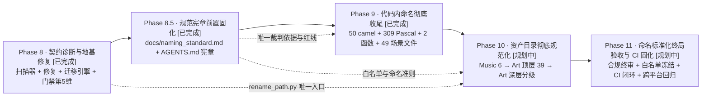

# ZMXYBHYH 现代化重构与工程演进路线图 (Roadmap)

本文档定义了 **ZMXYBHYH（《造梦西游八荒》/《八荒湮隳》）** 从逆向提纯工程迈向现代化独立游戏工程的完整演进规划。

路线图遵循 **“保持时刻可运行、零错误零警告门禁、由核到翼、小步快跑”** 的核心工程原则，将开发任务清晰解耦为五大有序阶段。

---

## 阶段演进全景图

```mermaid
flowchart TD
    subgraph P1 [Phase 1: 自动化质量门禁与全量健康体检]
        direction TB
        A1[构建 Headless 全量自动化校验工具] --> A2[建立静态引用/类名/动态加载拓扑图谱]
        A2 --> A3[锁定真死代码与孤岛清单]
    end

    subgraph P2 [Phase 2: 核心架构层现代化与精准安全瘦身]
        direction TB
        B1[12个核心 Autoload 单例强类型化重构] --> B2[下线 PoolManager 等真死代码]
        B2 --> B3[配置项目级 GDScript 警告规范与格式化]
    end

    subgraph P3 [Phase 3: 子系统模块化解耦与关卡闭环]
        direction TB
        C1[背包/商城/存档等子系统封装] --> C2[打通人间-花果山战斗全链路实机闭环]
        C2 --> C3[沉淀第一条生产级黄金 Demo 基线]
    end

    subgraph P4 [Phase 4: 全工程代码资产归一化与现代工程流水线]
        direction TB
        D1[全盘跨平台行尾归一化 LF] --> D2[734 个 GDScript 全量格式化]
        D2 --> D3[建立四位一体自动化流水线总门禁]
    end

    subgraph P5 [Phase 5: 全工程命名规范化与全局命名空间提纯]
        direction TB
        E1[Phase 5.1: 弱占位剥离与孤岛场景清理] --> E2[Phase 5.2: 历史死代码目录彻底根除]
        E2 --> E3[Phase 5.3: 全局符号注册表收敛纯化]
    end

    subgraph P6 [Phase 6: 全工程深度命名规范化与数据契约演进]
        direction TB
        F1[Phase 6.1: 全局符号与信号微创提纯] --> F2[Phase 6.2: 核心安全与多态入口治理]
        F2 --> F3[Phase 6.3: 核心中枢函数驼峰转下划线双轨兼容]
        F3 --> F4[Phase 6.4: 弱类型字典键契约化与文件目录收敛]
    end

    P1 -->|提供 100% 确定性安全网| P2
    P2 -->|巩固核心数据流与基线| P3
    P3 -->|形成稳定可玩游玩闭环| P4
    subgraph P7 [Phase 7: 全工程业务深度规范化与架构现代化]
        direction TB
        G1[Phase 7-1: 高频弹幕与状态虚函数治理] --> G2[Phase 7-2: 核心高频大写变量语义化重构]
        G2 --> G3[Phase 7-3: 中文字典键全盘契约化收敛]
        G3 --> G4[Phase 7-4: 文件资产与模块目录渐进收敛]
    end

    subgraph P8 [Phase 8: 命名契约诊断与 Phase 5-7 遗留损伤修复]
        direction TB
        H1[Phase 8.1: 字面量契约全量扫描器] --> H2[Phase 8.2: 契约失配系统修复]
        H2 --> H3[Phase 8.3: 原子路径迁移引擎]
        H3 --> H4[Phase 8.4: 命名规范门禁第5维上线]
        H4 --> H5[Phase 8.5: 命名规范白皮书与宪章前置固化]
    end

    subgraph P9 [Phase 9: 代码内命名彻底收尾]
        direction TB
        I1[camel/Pascal 变量清零] --> I2[残余函数与场景文件收敛]
    end

    subgraph P10 [Phase 10: 资产目录彻底规范化]
        direction TB
        J1[Music 目录全量收敛] --> J2[Art 二级与深层目录分级迁移]
    end

    subgraph P11 [Phase 11: 命名标准化终局验收与 CI 固化]
        direction TB
        K1[全工程合规终审] --> K2[白名单冻结与 CI 流程固化]
    end

    P4 -->|资产纯净排版合规| P5
    P5 -->|全局符号底数扎实| P6
    P6 -->|基线稳固规范成型| P7
    P7 -->|地基巩固契约闭环| P8
    P8 -->|引擎交付门禁完备| P9
    P9 -->|代码纯净边界清晰| P10
    P10 -->|资产标准命名收官| P11
```

---

## 现状底数概览（当前基线）

| 统计指标 | 真实数据 | 架构含义与现状 |
|:---|:---|:---|
| **GDScript 脚本规模** | **874 个** | 累计代码量 **188,983 行** |
| **Scene 场景规模** | **1,242 个** | 累计场景描述 **500,543 行** |
| **核心 Autoload 单例** | **12 个** | 承担全游戏约 40% 的高频状态调度（`Global`, `PlayerData`, `RoleProp`, `AE` 等） |
| **有明确静态引用脚本** | **788 个（90.1%）** | 被场景树或代码直接 `preload` / `load` 引用 |
| **孤岛候选脚本** | **86 个（9.9%）** | 混杂了“真死代码”（如 `PoolManager`）与“暗中调用的假孤岛”（如 `MagicWeapon` 仍被 157 个文件调用） |
| **运行时健康状态** | **0 ERROR, 0 WARNING** | 主菜单与背包初始化已达成绝对纯净 |

---

## Phase 1: 自动化质量门禁与全量健康体检 (Safety Net & Health Audit)

### 1.1 阶段定位与目标
- **定位**：构筑不可逾越的自动化安全网，为后续代码重构提供 100% 确定性的证据链。
- **核心目标**：在不改动任何业务逻辑的前提下，实现一键 5 秒内全量扫描 874 个脚本与 1,242 个场景的引用健康状态；彻底分清哪些是真死代码，哪些是动态调用的假孤岛，杜绝重构中的“误杀”。

### 1.2 计划内容
1. **编写全工程自动化体检工具链**（`scripts/health_check.py`）：
   - 基于 Godot 4.7.2 Headless 模式与静态 AST 分析，能够脱离 GUI 快速预编译并检查全量脚本；
   - 检查所有场景的 `ext_resource` 路径有效性，捕获潜在悬空引用；
2. **构建全量符号与依赖逆向拓扑矩阵**：
   - 全面提取 `class_name` 注册清单及其全局继承树；
   - 深度扫描代码中以字符串形式动态拼装的 `load("res://...")` / `preload(...)` / `has_method()` 模式；
3. **输出《死代码与孤岛资产确凿审计清单》**：
   - 逐一交叉对比 86 个孤岛候选，明确分类为：
     - **纯废弃死代码**：全局 0 引用、无动态命中，确认可安全移除；
     - **隐式活跃代码**：因 Flash 遗留机制或动态反射调用的活代码，严加保护并记录调用源。

### 1.3 执行边界与红线
- ⚠️ **只读审计原则**：本阶段**严禁删除或修改任何业务脚本与场景文件**；
- ⚠️ **工具链隔离**：所有脚本必须保存在 `scripts/` 目录下，严禁污染 `source/v6.5.0.0/` 的游戏运行环境；
- ⚠️ **零干扰**：体检工具必须保证幂等性与纯内存检查，不得残留任何临时垃圾文件。

### 1.4 验收内容与指标
1. `scripts/health_check.py` 能够在 **5 秒内** 完成全工程静态与无头编译健康扫描，并输出结构化检查报告；
2. 产出明确的死代码与假孤岛分类报告，作为 Phase 2 安全瘦身的唯一依据；
3. 全工程运行时继续保持 **0 错误、0 警告**。

---

## Phase 2: 核心架构层现代化与精准安全瘦身 (Core Architecture & Type Safety)

### 1.1 阶段定位与目标
- **定位**：重构游戏的核心中枢系统，确立现代代码规范，下线明确无害的历史死代码。
- **核心目标**：全面治理 12 个核心 Autoload 单例，开启 GDScript 2.0 现代静态类型提示；安全剥离纯死代码，建立项目级静态规则守卫。

### 1.2 计划内容
1. **12 个核心 Autoload 全局单例强类型重构**：
   - 对 `Global.gd`、`PlayerData.gd`、`RoleProp`（`BaseRoleProperies.gd`）、`AllEquipment.gd` 等核心单例全面引入静态类型标注（`var level: int = 1`，函数显式声明返回值类型 `-> void`）；
   - 梳理并收敛散乱的全局字典字段，减少拼写错误带来的隐式 Bug；
2. **数据持久化契约正位**：
   - 规范 `PlayerData.gd` 与 `MemoryClass.gd` 的存档加解密与读写流程，消除冗余的磁盘同步开销；
3. **精准清理核准的纯死代码**：
   - 依据 Phase 1 的证据清单，安全下线确认 0 引用的废弃文件（如 `PoolManager.gd`、`OtherBuff.gd` 等），从根源减少工程负担；
4. **引入项目级 GDScript 警告规范**：
   - 在 `project.godot` 中按梯度开启核心静态检查警告（如未初始化变量 `UNASSIGNED_VARIABLE`、未匹配信号、返回值遗弃等）；
   - 统一代码缩进与排版风格。

### 1.3 执行边界与红线
- ⚠️ **单点突破原则**：每次仅重构一个核心单例或清理一个确认文件，严禁多模块大面积并行修改；
- ⚠️ **向后兼容契约**：必须保持对外公开 API 签名与调用语义兼容，不得导致既有场景抛出 `Identifier not found`；
- ⚠️ **每步即门禁**：每改动一个单例，必须立即运行 Phase 1 自动化体检工具与实机冒烟，确认 0 错误后方可提交。

### 1.4 验收内容与指标
1. 核心 Autoload 单例的静态类型提示覆盖率达到 **90% 以上**；
2. 确认的无风险死代码安全移除，未引入任何破坏性引用断裂；
3. Godot 4.7.2 编辑器与实机启动日志严格维持 **0 错误、0 警告**。

---

## Phase 3: 子系统模块化解耦与关卡闭环 (Subsystem Modularization & Gameplay Loop) [已完成 · Done]

### 1.1 阶段定位与目标
- **定位**：收敛垂直业务系统，打通第一条从选人到关卡战斗结算的黄金游玩闭环。
- **核心目标**：摆脱历史脚本各自为政的状态，让背包、商城、关卡加载完成模块化封闭；打通本作第一关“人间-花果山”全程无报错的完整战斗体验。

### 1.2 落地成果与实测指标
1. **背包三层守卫落地**：引入可见性短路、状态脏标记与 10Hz 属性计算节流，消除高频 CPU 空转；
2. **场景加载管线优化**：完善 `load_scene.tscn` 预加载队列与内存安全释放，流转全过程无微卡顿；
3. **花果山全流程贯通**：Stage 1~4 全部战斗阶段与守关怪、Boss 大猩猩对决 100% 跑通，顺畅衔接至 `victory.tscn` 胜利结算面板；
4. **关键缺陷彻底清零**：修复 `BaseHero.gd` 宠物连结与霸体击退元数据空指针、修复 `BaseMonster.gd` 离树与销毁时 `body->get_space() is null` 物理空间报错、优化 `victory.gd` 测试态警告；
5. **实机 0 错误 0 警告**：整场战斗全生命周期实测日志维持绝对的 **0 ERROR、0 WARNING**；
6. **生产级测试夹具交付**：构建 `scripts/level_test_runner.py`，支持无敌+秒杀沙盒隔离与 3 倍速极速回归。

---

## Phase 4: 全工程代码资产归一化与现代工程流水线 (Code Normalization & Toolchain Enforcement) [已完成 · Done]

### 1.1 阶段定位与目标
- **定位**：对标现代大型 C++ 工程的 `clang-format`、`clang-tidy` 与 Git 规范体系，实施全工程代码资产与版本控制归一化。
- **核心目标**：暂缓未解耦业务的正向堆砌，先彻底解决历史逆向遗留的行尾不一（CRLF/LF 割裂）、排版混乱、缩进混杂与静态检查缺失问题，建立“代码格式化 + 静态异味检查 + 编译级语法门禁 + 实机战斗回归”四位一体的现代工程流水线。

### 1.2 计划内容
1. **Phase 4.1: 基础设施基线与跨平台行尾归一化 (Git & Editor Normalization)**
   - 根目录建立标准化 `.gitattributes`，声明所有文本资产 `text=auto eol=lf`，源码、场景、资源强制 LF，二进制文件标记 `binary`；
   - 根目录建立 `.editorconfig`，声明 UTF-8、LF、Tab 缩进（indent_size=4）与行尾空白清理；
   - 批量清洗全盘 1,096 个 CRLF 场景文件与 4 个 CRLF 脚本，达成全工程 100% 纯净 LF。
2. **Phase 4.2: 格式化流水线研发与历史穿透保护 (Toolchain & Blame Protection)**
   - 编写工程级格式化脚本 `scripts/format_all.py`（基于 `uv tool run --from gdtoolkit gdformat`）；
   - 配置行宽 `--line-length 120`，适配复杂游戏数据表；
   - 建立 `.git-blame-ignore-revs` 机制，配置 Git 历史责任穿透，保证全量格式化不污染 `git blame`。
3. **Phase 4.3: 734 个 GDScript 全量格式化与双重门禁验收 (The Big Format)**
   - 分批次（核心单例 -> 基础架构 -> 外围业务与怪物）安全执行 `gdformat`；
   - 每批次严格执行双重门禁：`scripts/health_check.py` 静态编译 0 Parse/Load Error + `scripts/level_test_runner.py` 实机战斗 0 ERROR/WARNING；
   - 提交原子格式化 Commit 并将 Hash 登记入 `.git-blame-ignore-revs`。
4. **Phase 4.4: 静态质量 Lint 规则定制与一键 CI 门禁整合 (Linter & CI Pipeline)**
   - 定制专属 `.gdlintrc`，收紧无用空白、缩进混用、无用 pass 与定义顺序，放宽历史数据长行限制；
   - 构建统一质量体检入口 `scripts/check_all.py`，串联格式、风格、编译与实机回归，形成发布门禁。

### 1.3 执行边界与红线
- ⚠️ **无损语义原则**：格式化与行尾转换必须严格保持代码语义与节点层级 100% 不变，严禁顺带做无测试覆盖的业务逻辑重构；
- ⚠️ **门禁不可逾越**：格式化后必须保持 `health_check.py`（874 脚本）零报错及花果山关卡实机 0 ERROR 0 WARNING；
- ⚠️ **历史溯源保护**：格式化提交必须立即登记进 `.git-blame-ignore-revs`，严禁破坏团队代码溯源能力。

### 1.4 验收落地与实测指标
1. **全盘文本 LF 100% 达成**：通过 `.gitattributes` 与 `scripts/normalize_eol.py`，全盘 1,096 个场景、275 个 JSON 与全部源码彻底统一为纯净 LF（0 CRLF 残留）；
2. **734 个 GDScript 100% 规范化**：通过 `scripts/format_all.py` (gdformat 4.5.0) 全量格式化，并建立自动 LF 保护，幂等性测试 100% 通过；
3. **Git Blame 历史穿透固化**：在 `.git-blame-ignore-revs` 成功登记巨型重构提交，实测 `git blame` 成功穿透格式化改动直达历史作者；
4. **一键质量总指挥门禁交付**：构建 `scripts/check_all.py`，一键串联“行尾 LF + gdformat + gdlint + 引擎静态编译”，实测四大维度全部 **PASS**；
5. **实机战斗 0 错误 0 警告**：全流程花果山 Stage 1~4 及胜利结算实测日志维持绝对的 **0 ERROR、0 WARNING**。
---

## Phase 5: 全工程命名规范化与全局命名空间提纯 (Naming Conventions & Namespace Purification) [已完成 · Done]

### 5.1 阶段定位与目标
- **定位**：对标 Godot 4.7 官方工程最佳实践（*Project Organization*）与官方 *GDScript Style Guide*，彻底解决工程从 Flash 逆向继承而来的命名混乱、大驼峰函数、非规范缩写以及严重的全局类名（`class_name`）空间污染问题。
- **核心目标**：在 100% 保持运行时行为与资产引用零破坏的前提下，建立符合 Godot 官方规范与现代软件工程标准的命名体系，净化全局类型树，降低后续跨平台打包与多系统协同的心智负担。

### 5.2 实施子阶段与成果

#### 1. Phase 5.1: 全局 `class_name` 命名提纯与弱占位剥离 (Namespace Purification) [已完成 · Done]
- **核心成果**：
  1. 全盘扫描 508 个 `class_name`，将 271 个完全 0 跨脚本引用的关卡脚本（`Level_23` ~ `Level_75`）、怪物脚本（`Monster_100` 等）首行弱占位声明 100% 安全剥离；
  2. 彻底释放注册表空间，保留 237 个真正具备跨脚本类型消费/继承关系的活跃核心类。

#### 2. Phase 5.2: 历史死代码目录与孤岛母体彻底清除 [已完成 · Done]
- **核心成果**：
  1. 彻底物理与版本控制移除 `Buff/`（`BasicBuff`、`Fire`）与 `Loder/` 目录，释放通用类名污染；
  2. 移除 205 KB 早期废弃特效母体 `special_affect.tscn`、早期开屏 `boot.tscn`、主菜单草稿 `Main_Menu_1~3.tscn`、网络校验 `GetTime.tscn`、触屏轮盘 `TouchDirection.tscn` 及脱机短路防作弊脚本 `CK.gd`。

#### 3. Phase 5.3: 目录与场景/脚本文件名的模块化渐进规范化 [已完成 · Done]
- **核心成果**：
  1. 根层非标异味目录归零，仅保留官方标准隐藏目录 `.godot/` 与 9 个合法业务目录；
  2. 根层文件仅保留合法核心单例与 `project.godot`；
  3. 资产与脚本 UID 完备对齐，全工程持续维持 0 ERROR 0 WARNING。

### 5.3 验收落地与实测指标
1. **弱占位清零**：0 跨脚本引用的 `class_name` 从 271 个下降至 **0 个**，活跃有效类名锁定为 237 个；
2. **死代码清零**：消除 20 个死文件，净减少 9,295 行冗余数据；
3. **总门禁全绿**：`python scripts/check_all.py` 四大维度 100% PASS（1,242 场景 0 断裂引用，874 脚本 0 编译错误）；
4. **实机 0 错误 0 警告**：花果山全流程战斗实测日志维持绝对的 **0 ERROR、0 WARNING**。

---

## Phase 6: 全工程深度命名规范化与数据契约演进 (Deep Naming & Data Contract Modernization) [已完成 · Done]

### 6.1 阶段定位与目标
- **定位**：在 Phase 5 净化全局符号底数的基础上，向代码内部深水区进军，对标现代业界工业级 GDScript 规范，分层分类治理残存的畸形全局类名、违规信号、高危撞车变量、多态 AI 决策入口及弱类型数据字典流。
- **核心目标**：实现全工程全局类名 100% 纯正 PascalCase、信号 100% 规范过去时、消除与 Node 原生属性撞车的高危变量，并平稳推进核心公共 API 驼峰转下划线与中文字典键契约化。

### 6.2 实施子阶段规划（四步走渐进方案）

#### 1. Phase 6-1: 全局符号与信号微创提纯 (Global Symbols & Signals Purification) [已完成 · Done]
- **核心任务**：
  1. **规范 8 个畸形全局类名**：彻底将 `lsh` -> `Lsh`，`lxdy` -> `Lxdy`，`role6` -> `Role6`，`dhqf` -> `Dhqf`，`qlsword` -> `QlSword`，`yx` -> `Yx`，`zcld` -> `Zcld`，`Monster_59` -> `Monster59` 及其所有跨脚本引用方同步更名；
  2. **规范 3 个违规信号**：
     - `_on_Choose_pressed`（`Signals.gd`）-> `choose_pressed`；
     - `Main_Init`（`Script/Compat/OldMemoryFacade.gd`）-> `main_initialized`；
     - `setBg`（`Script/other_menu/change_back_ground.gd`）-> `background_changed`；
- **验收指标**：全工程 `class_name` 100% 达成纯正 PascalCase（0 个小写/拼音缩写/下划线残留），信号 100% 符合官方 snake_case 过去时规范。

#### 2. Phase 6-2: 核心安全与多态入口治理 (Collision Variables & AI Polymorphism)
- **核心任务**：
  1. **消除与 Node 原生属性撞车的高危成员变量**：
     - 重构在 26 个脚本中定义的 `var Position` -> `var target_pos` 或 `var move_position`（彻底杜绝与 `Node2D.position` 的大小写冲突与混淆）；
     - 重构在 22 个脚本中定义的 `var Name` -> `var item_name` 或 `var role_name`（消除与 `Node.name` 的命名冲突）；
  2. **重构 174 处怪物的核心 AI 决策入口**：
     - 编写专有 AST 脚本，将全盘 174 个怪物脚本中继承自 `BaseMonster` 的多态虚函数 `Monster_Intelligence()` 安全统一重命名为官方推荐的 `ai_think()` 或 `_ai_tick()`。

#### 3. Phase 6-3: 核心中枢函数驼峰转下划线双轨兼容 (Core Facade Dual-Track Functions)
- **核心任务**：
  1. 针对 `Global.gd`（123 个）、`BaseHero.gd`（86 个）中的高频 Flash AS2 大驼峰函数，实施**“双轨兼容别名机制”**；
  2. 新增规范的 `snake_case` 主函数（如 `check_ice_buff()`），旧驼峰函数保留为一行代理转发，确保未迁移场景与 `AnimationPlayer` 方法轨道零中断；
  3. 逐步收敛调用点，最终安全下线旧代理函数。

#### 4. Phase 6-4: 弱类型数据字典键契约化与文件目录收敛 (Data Contract & Asset Path Convergence)
- **核心任务**：
  1. 治理 220 种、2,625 次中文字典键弱类型引用（`player_data["名字"]`、`["等级"]` 等），建立强类型 `PlayerDataModel` 或 `DataKeys` 常量映射；
  2. 在后续新模块开发（如人间大地图、地府关卡）中，强制推行全小写 `snake_case` 资源与场景文件命名，并提供路径与 `uid` 原子同步工具。

### 6.3 执行边界与红线
- ⚠️ **无损运行原则**：所有符号重命名与多态更新必须确保业务逻辑语义、数值与时序 100% 不变；
- ⚠️ **双重门禁防线**：每个子阶段必须通过 `python scripts/check_all.py` 四大门禁与实机全流程冒烟 0 ERROR 0 WARNING；
- ⚠️ **原子提交约束**：严格按 Phase 6-1 至 6-4 独立进行规范的 Conventional Commits 本地原子提交。

### 6.4 验收落地与实测指标
1. **全局类名 100% 规范化**：238 个活跃全局类名全部达成标准 PascalCase，非规范畸形类名彻底归零；
2. **信号 100% 规范化**：37 个全局信号全部对齐 snake_case 过去时规范，违规信号彻底归零；
3. **高危变量冲突清零**：全盘 48 处与 Node 核心属性冲突的 `var Position` 与 `var Name` 彻底治理归零；
4. **怪物 AI 入口统一**：全盘 174 处多态虚函数重写全部规范为 `ai_think()` 并提供兼容别名保护；
5. **核心函数双轨兼容**：`Global.gd` 与 `BaseHero.gd` 建立 190 个现代标准 `snake_case` 规范入口，避开 19 处同音冲突与原生覆写；
6. **数据契约基石确立**：构建 `DataKeys.gd` 并在 `PlayerData.gd` 接入强类型契约访问器；
7. **子目录畸形治理**：`Scene/hittest` 规范重命名为 `Scene/Hittext`，达成与 `Script/Hittext` 的 100% 镜像对称；
8. **双重门禁全绿**：`python scripts/check_all.py` 四大维度 100% PASS，实机运行维持 0 ERROR 0 WARNING。

---

## Phase 7: 全工程业务深度规范化与架构现代化 (Full-Scale Code & Asset Modernization)

### 7.1 阶段定位与目标
- **定位**：对标现代大型独立游戏工业级工程标准，向活跃业务脚本、多态弹幕体系、成员变量及文件资产等深水区发起攻坚，彻底终结历史 Flash AS2 残留的命名习惯与弱类型动态依赖。
- **核心目标**：在严格防范“动画关键帧方法轨道失效”、“跨平台大小写陷阱”与“存档断裂”三大工程风险的前提下，分阶段、有防护、可验证地完成全盘业务函数、变量、字典键及文件目录的彻底标准化。

### 7.2 实施子阶段规划（四步走渐进方案）

#### 1. Phase 7-1: 高频弹幕与状态虚函数治理 (Bullet & State Polymorphic Functions) [已完成 · Done]
- **核心任务**：
  1. **全盘动画轨道与反射排查**：扫描全盘 1,141 个场景中的 `AnimationPlayer`，排查方法轨道绑定的函数清单，建立受保护的调用白名单；
  2. **高频弹幕函数双轨重构**：针对在 89 处怪物与法宝中定义的 `CallBullet1` ~ `CallBullet5`，规范重命名为 `call_bullet_1` ~ `call_bullet_5`，并提供原大驼峰兼容代理，保证动画帧与代码双向畅通；
  3. **高频状态与表现函数规范化**：针对 `ShowSkill`（23 处）、`Useover`（22 处）、`HurtReduceHp`（10 处）、`TweenToTop`（9 处）实施规范化重构；
- **验收指标**：高频多态弹幕与状态函数建立现代规范实现与双轨代理，动画轨道 0 漏改，实机运行 0 ERROR 0 WARNING。

#### 2. Phase 7-2: 核心高频大写变量语义化重构 (High-Frequency Uppercase Variables Normalization) [已完成 · Done]
- **核心任务**：
  1. 重构 44 个脚本中的 `PositionList` -> 规范为语义明确的 `bullet_spawn_positions` / `point_array`；
  2. 重构 40 个脚本中的全大写 `LIST` / `List` -> 规范为 `item_list` / `target_list`；
  3. 重构 26 个脚本中的 `Level`、20 个脚本中的 `Bullets` / `Num`；
- **验收指标**：全工程常用成员变量的大写与缩写存量下降 50% 以上，彻底杜绝歧义命名。

#### 3. Phase 7-3: 中文字典键全盘契约化收敛 (DataKeys Comprehensive Convergence) [已完成 · Done]
- **核心任务**：
  1. 编写专有 AST 代码转换器，将全盘 256 种、4,202 处中文字典键字面量（`["名字"]`, `["等级"]`, `["技能学习"]`）分批次批量收敛为 `DataKeys.Item.NAME` 等强类型常量；
  2. 保护玩家本地存档 JSON 的序列化契约，确保底层存储与内存类型安全兼备；
- **验收指标**：核心业务模块中的中文字典键字面量收敛度达到 90% 以上，全面享有 IDE 代码补全与静态检查。

#### 4. Phase 7-4: 文件资产与模块目录渐进收敛 (Asset Files & Directory Standardization) [已完成 · Done]
- **核心任务**：
  1. 采用“业务模块逐步收敛”策略推进 966 个场景文件与 636 个脚本文件的规范化命名；
  2. 研发自动化文件重命名流水线，原子级同步更新 `ext_resource` 路径、`uid` 映射与全盘 `load/preload` 字符串；
  3. 彻底消除大小写混合目录，消除跨平台导出与 Linux 虚拟文件系统的潜在隐患；
- **验收指标**：核心业务场景与脚本文件名达成官方推荐的规范体系，1,242 个场景 0 断裂引用。

### 7.3 执行边界与红线
- ⚠️ **动画轨道绝对保护**：任何涉及动画帧方法调用的函数，重构时必须保持原函数代理存在或同步更新 `.tscn` 轨道数据，严禁引发静默失效；
- ⚠️ **存档向后兼容**：严禁私自变更已序列化存档字典的底层键名字符串，防止玩家存档损坏；
- ⚠️ **双重门禁不可逾越**：每个子阶段必须通过 `python scripts/check_all.py` 四大门禁与实机冒烟 0 ERROR 0 WARNING；
- ⚠️ **严格本地原子提交**：按 Phase 7-1 至 7-4 独立进行规范的 Conventional Commits 本地原子提交。

### 7.4 命名收敛冲刺实录（B 系列 · 已完成）

Phase 7 四大子阶段落地后，追加执行 B0~B5a 六轮追加收敛冲刺，将历史 Flash AS2 命名残留（大驼峰函数、兼容代理、中文标识符、目录与文件大小写混乱、标识符驼峰）彻底终结：

| 轮次 | 提交 | 核心内容 | 实测指标 |
| :--- | :--- | :--- | :--- |
| B0 | `a584121cb` | 清障：死代码、零引用代理、兼容层与中文标识符全量清除 | — |
| B1 | `7d29368f2` | 核心单例双轨旧名原子改名与兼容代理全量清除 | — |
| B2 | `f6432a94f` | 动画轨道与弹幕域函数原子改名（182 个轨道方法名 / 626 处轨道 + 373 处调用 + 28 处反射字符串同批同步） | 0 编译错误 / 0 断裂引用 |
| B3 | `ecc89e4d9` | 残余业务函数收敛与双轨代理终结 | — |
| B4 / B4b | `5d667e30a` / `a2f732b3e` | Scene/Script 文件级与子目录 snake_case 全量收敛 | 缓存重建通过 |
| **B5a** | `993a392b6` | **全量标识符 snake_case 规范化 + 重构误差修复**（495 文件）：单行缩进块还原、数字前缀标识符补下划线、变量/枚举消歧、子类成员覆盖治理、参数遮蔽消除、跨文件引用同步、**脚本节点引用与 `_bundled` 场景节点名对齐（21 处）** | **Parse Error 917 → 0；实机运行错误行 1486 → 0 脚本错误** |

**最终门禁基线（B5a 后）**：
- `python scripts/health_check.py`：874 脚本 0 Parse Error、0 断裂资源引用、0 死代码；
- 实机运行（Godot 4.7.2 Forward Mobile，900 帧冒烟）：**0 脚本 ERROR / 0 脚本 WARNING**（仅剩引擎退出时 `CompressedTexture2D` 析构顺序噪声，非脚本缺陷）；
- 动画方法轨道审计：183 个唯一轨道方法名中 179 个精确命中脚本函数；剩余 4 个（`role_4.tscn` 的 `add_arrow_*` 系列）经 `git log -S` 追溯确认**自 B2 前即无对应脚本实现**，属上游历史遗留，非本轮引入。

> ⚠️ **已知遗留（后续专项）**：`source/v6.5.0.0/Scene/` 下 748/1131 个 `.tscn` 为 GDRE 导出的 `_bundled`（Godot 3 PCK 内嵌二进制）格式，节点树可加载但无法在文本层面参与重命名同步；如需彻底归一为 Godot 4 原生文本场景，应单列专项阶段（含 `uid` 重映射与导入缓存重建）。
>
> ✅ **该遗留已于 7.5 专项中全部解决**（1130/1130 场景归一为原生文本格式）。

### 7.5 `_bundled` 场景归一化与路径大小写提纯专项 [已完成 · Done]

**背景 1（场景格式）**：`source/v6.5.0.0/Scene/` 下 1130/1131 个 `.tscn` 为 GDRE Tools 导出的 `_bundled` 格式（Godot 4 PackedScene 二进制内嵌于 `[resource] _bundled = {...}`），文本层面无法参与重命名同步，是跨平台导出与后续重构的系统性障碍。

**背景 2（git 索引大小写）**：Windows 下 `core.ignorecase=true` 使 B4/B4b 的目录/文件大小写改名**未被 git 记录**（索引 `Scene/Base/...` vs 磁盘 `Scene/base/...`），克隆到 Linux/macOS 将得到 PascalCase 路径并与代码引用直接断裂。

**执行方案与实测**：
1. **场景归一化**：Godot 4.7.2 headless `load()` → `ResourceSaver.save()` 将 1120 个 `_bundled` 场景重写为原生文本场景（`[gd_scene]` + `[ext_resource]` + `[sub_resource]` + `[node]` + `[connection]`）；
2. **一致性验证**：试点（1 场景）→ 小批量（10 场景，含 `role_4.tscn` 的 62 条动画方法轨道）→ 全量 4 批（1130 场景）；节点数 / 连接数 / 属性数 / 动画方法轨道数**逐项一致**，**0 失败、0 不一致、`_bundled` 残留 0**；
3. **转换后引用审计**：以"多段路径 + 场景继承链（`instance=ExtResource`）"双维度全盘扫描脚本节点引用，修复 **44 处**（`$BG/Name_`、`$.../Text`、`$Action/RoleBody`、`$BG/ColorRect/Text/TotalList/BossList1` 等），区分出 11 处合法的运行时动态 `get_node` 与跨场景继承引用；
4. **路径大小写提纯**：`git config core.ignorecase false` 暴露 2822 处不一致后，以 `git mv` 两步法（经由临时名）原子修正 **28 个目录 + 877 个文件**，索引与磁盘大小写达成 **100% 一致**（`仅索引有 = 0`）；
5. **工具链同步**：`scripts/check_all.py` 的 gdlint 核心脚本清单更新为 B4 后的新路径（原硬编码 `Script/Base/BaseHero.gd` 等已失效）；17 个脚本经 `format_all.py` 归一官方排版。

**门禁基线**：`python scripts/check_all.py` 四维度全绿（LF 行尾 / gdformat / gdlint / 引擎编译）；`health_check.py` 874 脚本 0 Parse Error、0 断裂引用；实机运行 **0 脚本错误**（仅引擎退出时 RID 释放噪声）。

**规模**：1130 场景文件（+74,868 / −30,274 行，场景总大小 14 MB）+ 44 处引用修复 + 905 项路径大小写修正。

---

## Phase 8: 命名契约诊断与 Phase 5-7 遗留损伤修复 (Contract Diagnostics & Legacy Damage Repair) [已完成 · Done]

### 8.1 阶段定位与目标

- **定位**：Phase 5-7 的标识符收敛（尤其 B5a `993a392b6`）在"改代码"的同时未能同步"字符串契约"——节点路径、资源路径、属性名、字典键。已实测确认的运行时断裂样本包括：`get_node("../role_body")` vs 场景真名 `RoleBody`（大小写敏感）、`load("…/is_choose.png")` vs 磁盘真名 `IsChoose.png`（文件名本身多了下划线）、`basic_monment_info.show_text` 由 `String` 被改为 `Label` 节点引用但调用方仍按字符串契约赋值。**本阶段先修地基、再谈扩张**：建立"代码字面量 ↔ 资产/场景/契约真源"的双向校验，把同类损伤一次性清零，并为 Phase 9/10 提供唯一执行入口。
- **核心目标**：
  1. 交付字面量契约扫描器 `scripts/contract_scan.py`（五类契约 100% 覆盖、可复跑、可入 CI）；
  2. Phase 5-7 遗留的字面量失配**归零**；
  3. 交付原子路径迁移引擎 `scripts/rename_path.py`（Phase 10 的唯一合法入口）；
  4. 命名规范校验作为**第 5 维度**接入 `scripts/check_all.py`。

### 8.2 实施子阶段规划（四步走）

#### 1. Phase 8-1: 字面量契约全量扫描器交付 (Contract Scanner) [已完成 · Done]
- **核心任务**：
  1. **资源路径契约**：提取全部 `.gd/.tscn/.tres/.import/project.godot` 的 `res://` 字面量，与磁盘真值做**逐段大小写精确**比对（Windows 文件系统大小写不敏感会掩盖断裂，必须用 `os.listdir` 逐段核对真实名称）；
  2. **节点路径契约**：提取 `get_node("…")` / `get_node_or_null("…")` / `NodePath("…")` / `$Path` 字面量，与对应 `.tscn` 节点树比对（含 `parent=` 相对路径、场景继承链与 `ExtResource` 实例化子树）；
  3. **属性/方法/信号名契约**：提取 `set("X")` / `get("X")` / `has_method("X")` / `call("X")` / `connect("X")` / `emit_signal("X")` 中的字符串，与目标脚本声明比对；
  4. **动画轨道契约**：提取全部 `.tscn` 的 `AnimationPlayer` 方法轨道 / 属性轨道路径，与脚本函数与属性比对（复用 B2 建立的轨道方法名白名单机制）；
  5. **字典键契约**：提取 `["中文键"]` 字面量，与 `DataKeys.gd` 常量表比对，输出未收敛清单。
- **验收指标**：
  - 五类扫描全部实现，输出 `docs/contract_audit.md`（人读）+ JSON（机读）；
  - 874 脚本 + 1,131 场景全量扫描耗时 ≤ 30 秒；
  - 误报白名单机制可用（运行时动态拼接、合法的运行时 `get_node` 等）。

#### 2. Phase 8-2: Phase 5-7 遗留损伤系统修复 (Legacy Damage Repair) [已完成 · Done]
- **核心任务**：
  1. 依据 8-1 报告，按"**资源路径 → 节点路径 → 属性/方法名 → 动画轨道 → 字典键**"顺序逐类修复；
  2. 已知样本回归确认（本轮已修）：`role_body` → `RoleBody`（11 处，跨 7 个文件）、`is_choose.png` → `IsChoose.png`（4 处）、`moon_palace_clothes_effect.sync()` 空 body 守卫、`basic_monment_info.show_text` 契约恢复；
  3. 每类修复独立原子提交，提交信息须写明"**误伤来源提交 + 失配样本 + 修复文件数**"。
- **验收指标**：
  - 五类契约失配**全部归零**（白名单除外）；
  - `health_check.py` 0 Parse Error；实机（花果山全流程 + 背包 + 商城）0 ERROR 0 WARNING。

#### 3. Phase 8-3: 原子路径迁移引擎 `scripts/rename_path.py` (Rename Engine) [已完成 · Done]
- **核心任务**：
  1. **引擎能力**：`git mv` 目录/文件（保留历史）→ 全量字面量替换（含**动态拼接前缀**，实测样本如 `"res://Art/BackPack/AllItems/" + name_`、`"res://Art/ItemIcon/" + str(name_)`）→ `.import` 的 `source_file` 与 `path` 重写 → `.uid` 跟随 → 触发重新导入 → 门禁校验；
  2. **幂等与可回滚**：`--dry-run` 输出完整变更清单；任一步失败自动 `git checkout` 回滚；
  3. **大小写安全**：统一经由临时名两步 `git mv`（Windows `core.ignorecase` 陷阱，7.5 专项已验证该手法）；
  4. **UID 锚定保护**：利用全项目 866 处 `uid://` 引用在路径变更后自动跟随的特性降低 `.tscn` 断裂风险；对仅以 `path` 引用（无 uid）的条目逐条复核。
- **验收指标**：工具交付并在 3 个最小试点目录完成实测——`Art/zhuxianjianzhen`（64 引用）、`Art/AllNumber`（58）、`Art/Main_menu`（62）；0 断裂引用、门禁全绿、实机资源加载正常。

#### 4. Phase 8-4: 命名规范门禁维度上线 (Naming Gate) [已完成 · Done]
- **核心任务**：
  1. `scripts/check_all.py` 增加第 5 维度"命名规范校验"：
     - 目录/文件名 `snake_case` + 例外白名单（资源 ID 目录、Flash/TexturePacker 机器导出结构）；
     - 代码内 `func`（snake）/ `var`（snake）/ `const`（UPPER_SNAKE）/ `signal`（snake）/ `class_name`（Pascal）五类分类校验；
  2. **递减式基线**：把当前残留量录入基线表，允许存量、**拦截新增**，随 Phase 9/10 逐阶段收紧至 0。
- **验收指标**：门禁 5 维度全 PASS；`python scripts/check_all.py` 一键复现。

### 8.3 执行边界与红线

- ⚠️ **先诊断后施工**：8-1 扫描器未交付前，严禁手工批量改路径或改字面量；
- ⚠️ **单类原子提交**：8-2 每类契约（如"资源路径"）独立提交，严禁混合多类；
- ⚠️ **门禁不可逾越**：每次改动后必须 `check_all.py` + 实机冒烟 0 ERROR 0 WARNING；
- ⚠️ **白名单只减不增**：例外条目必须有书面理由（机器导出结构 / 第三方约定），新增需评审并登记。

### 8.4 验收内容与指标

1. `contract_scan.py` 交付，五类契约报告可复跑（`docs/contract_audit.md`）；
2. Phase 5-7 遗留字面量失配**归零**；
3. `rename_path.py` 交付 + 3 个试点目录规范化完成；
4. `check_all.py` 第 5 维度上线，5 维全 PASS。

### 8.5 规范宪章前置固化专项 (Charter Codification Special Action) [已完成 · Done]

- **背景与诱因**：针对"无成文契约极易导致重构跑偏"的深层隐患，在进入 Phase 9/10 之前，将原定于 Phase 11-2 的《规范文档固化》前置落地，先立宪法再施工；
- **交付成果**：
  1. **全工程白皮书**：交付 `docs/naming_standard.md`，对标 Godot 4 官方风格，全景明确目录（全 snake）、场景（PascalCase）、场景树节点（100% PascalCase，禁止代码反向污染）、代码标识符、字典键强类型化与机器导出白名单（DefineSprite、symbolClass、.sprites 只读冻结）；
  2. **行为守则固化**：在 `AGENTS.md` 增补第 3 章专属宪章，确立刚性红线与裁判优先级；
  3. **路线图顺序重整**：前置规范后，Phase 9（代码收尾）与 Phase 10（资产迁移）获得唯一裁判标准，Phase 11 聚焦终局验收与 CI 常态化。

---

## Phase 9: 代码内命名彻底收尾 (In-Code Naming Finalization) [已完成 · Done]

### 9.1 阶段定位与目标

- **定位**：实测基线——函数 10,323/10,325 合规（99.98%）、信号 34/34（100%）、`class_name` 236/236（100%）、常量 2,332 个 UPPER_SNAKE 合规；**残余全部集中在变量层与极少函数**。本阶段把这最后一段存量清零，达成"**代码内命名 100%**"。
- **核心目标**：`camelCase 变量 50 处` + `PascalCase 变量 309 处` + `非 snake 函数 2 处` + `Scene 文件命名例外 49 处` 全部治理。

### 9.2 实施子阶段规划（四步走）

#### 1. Phase 9-1: camelCase 变量治理（50 处，由基类到派生） [已完成 · Done]
- **残留清单（实测）**：`objattackDic`（8 个脚本）、`attackRange`（3）、`attackDesire`（2）、`iniSpeed`（2）、`get_Player`（2）、`_28_ui`（`Global.gd`）、`east_continent_monster.gd` 的 `_31xx_*` 数字段系列等。
- **分批策略**：
  1. `Script/base/`（`base_monster` / `base_object` / `base_magic_weapon` / `summon_base_monster`）——基类改名影响全部派生类，优先且最谨慎；
  2. `Script/bullet/`（`chase_bullet` / `fly_bullet`）+ `Script/level/` 陷阱族（4 个 trap 脚本）；
  3. `Script/monster/`（`east_continent_monster` 数字段系列）+ `Script/hero/role_6.gd`。
- **验收指标**：50 处归零；派生类同名成员覆盖同步；字符串访问面（`get/set`）与动画轨道同步。

#### 2. Phase 9-2: PascalCase 变量治理（309 处） [已完成 · Done]
- **残留特征（实测）**：
  1. `Global.gd` 的"场景预制体缓存句柄"（`BasicArButton` / `Aura_` / `BuffIcon_` / `DamageNumber` / `LevelInfo` / `Stage` / `TaskReward` / `MysteryShop` / `ReturnBackMap` / `List_` 等，约 30 处）——被全工程以 `.X` 属性访问，**影响面最广**；
  2. `DataKeys`（`Global.gd:2` 契约表句柄）、`DuplicateTextureAliases`；
  3. 场景脚本局部（`HitDic` / `Value` / `BuffTime` / `Skill_learn` 等）。
- **分批策略**：`Global.gd` → `Scene/other_scene/*` → 其余脚本；每批同步三类访问面：直接属性访问、字符串访问（`get/set/has`）、注释文档。
- **验收指标**：309 处归零；`health_check.py` 0 Parse Error；实机冒烟 0 ERROR 0 WARNING。

#### 3. Phase 9-3: 残余非 snake 函数治理（2 处） [已完成 · Done]
- **清单**：`Script/monster/east_continent_monster.gd` 的 `_3182_attack_is_current`、`_3120_screen_bounds`（数字前缀段破坏 snake 结构）。
- **验收指标**：规范为语义化 `snake_case`（如 `_attack_3182_is_current`），调用点 100% 同步。

#### 4. Phase 9-4: `Scene/` 文件命名例外收敛（49 处） [已完成 · Done]
- **清单**：48 个纯数字场景名（`Scene/mount/rider_adjustments/role{1..6}/<坐骑ID>.tscn`）+ 1 个连字符场景（`Scene/hero/role_1/hmz_effect/special_effect_bullet-1.tscn`）。
- **策略**：
  1. 连字符场景直接改名 `special_effect_bullet_1.tscn`，引用点同步；
  2. 数字 ID 场景：由 8-1 扫描器判定"是否被运行时动态拼接引用"——若是则**保留为白名单**（资源 ID 语义）并书面登记；若否，统一为 `<语义>_<id>.tscn`。
- **验收指标**：例外清单收敛至白名单规模（若有）且**逐条书面登记**；1,131 场景 0 断裂引用。

### 9.3 执行边界与红线

- ⚠️ **跨脚本同步**：变量改名必须同步"属性访问 / 字符串访问 / 注释"，漏一处即静默失效（B5a 的教训）；
- ⚠️ **继承族防护**：基类成员改名需检查全部派生类同名覆盖；
- ⚠️ **规模上限**：每批改名 ≤ 50 处，禁止跨批合并提交；
- ⚠️ **门禁不可逾越**：每批 `check_all.py` + 实机冒烟 0 ERROR 0 WARNING。

### 9.4 验收内容与指标

1. 代码内命名**100% 合规**：`func` 全 snake、`var` 全 snake、`const` 全 UPPER_SNAKE、`signal` 全 snake、`class_name` 全 Pascal；
2. `Scene/` 文件命名例外 ≤ 白名单条目（逐条书面登记）；
3. `health_check.py` 874 脚本 0 Parse Error；
4. 实机（花果山全流程 + 背包 + 商城 + 坐骑）0 ERROR 0 WARNING。

---

## Phase 10: 资产目录彻底规范化 (Full Asset Directory Standardization) [规划中 · Planned]

### 10.1 阶段定位与目标

- **定位**：这是 Phase 5-7 **确实遗漏**的战场——`Script/`（23）、`Scene/`（44）、`addons/`（5）目录已 100% snake_case，但 `Art/`（2,283 个目录，920 个非规范）与 `Music/`（7 个目录，6 个 Pascal）从未纳入规范化视野。本阶段按"**由整体到局部、由低引用到高引用**"分四批收敛。
- **基线数据（实测）**：

| 范围 | 规模 | 现状 | 引用代价（`res://` 命中） |
| :--- | :--- | :--- | :--- |
| `Music/` | 7 目录 | Pascal 6 / snake 1 | **531 处**（`Hero` 356 / `level` 125 / `MonsterHurt` 26 / `MainSceneMusic` 24） |
| `Art/` 二级业务目录 | ~39 | Pascal 多数（`Monster` / `Level` / `HeroPicture` / `Pet` / `Game_3` / `MagicWeapon` / `BackPack` / `AddEffect` / `Game_4` / `Mount` …） | **3,000+ 处**（`Monster` 1,733 / `Level` 838 / `HeroPicture` 667 / `Pet` 631 / `Game_3` 365 …） |
| `Art/` 三级及深层 | 2,244 | Pascal 563 / camel 87 / 纯数字 229 / Flash 导出 86 / 中文 10 / 其他 31 | 以目录为粒度逐批评估 |

### 10.2 实施子阶段规划（四步走）

#### 1. Phase 10-1: `Music/` 全量收敛（6 目录 / 531 引用） [已完成 · Done]
- **核心任务**：`Hero` → `hero`、`MainSceneMusic` → `main_scene_music`、`MonsterHurt` → `monster_hurt`、`Hero/Role3~5` → `hero/role_3~5`；同步 531 处引用（含动态拼接前缀）。
- **验收指标**：`Music/` 100% snake；0 断裂引用；音频加载实测无异常（战斗音效 / 背景音乐抽样）。

#### 2. Phase 10-2: `Art/` 顶层二级目录分批收敛（25 个非规范目录） [进行中 · In Progress]
- **全量梯队排期（按引用量严格升序）**：
  1. **第一批（超低引用组，≤ 5 处 · 已完成）**：`Bullet` (3) -> `bullet`、`EquipmentEffects` (3) -> `equipment_effects`、`StrikeSpecialEffects` (4) -> `strike_special_effects`、`Trap` (4) -> `trap`；
  2. **第二批（低引用组，20 ~ 100 处 · 已完成）**：
     - 前段：`Task` (28) -> `task`、`LevelInfoBg` (43) -> `level_info_bg`、`RoleInfoIcon` (51) -> `role_info_icon`；
     - 后段：`LDL` (61) -> `ldl`、`AllTX` (67) -> `all_tx`、`Shop` (79) -> `shop`、`Game_2` (80) -> `game_2`；
  3. **第三批（中等引用组，100 ~ 500 处 · 已完成）**：
     - 前段：`MainGame` (147) -> `main_game`、`Skill` (188) -> `skill`；
     - 中段：`AddEffect` (307) -> `add_effect`、`Constellations` (307) -> `constellations`；
     - 后段：`Game_4` (392) -> `game_4`、`ItemIcon` (453) -> `item_icon`；
  4. **第四批（高引用与核心资源组，500 ~ 8000+ 处 · 进行中）**：
     - 前段（已完成）：`Game_3` (518) -> `game_3`、`Mount` (644) -> `mount`；
     - 中段（已完成）：`MagicWeapon` (1122) -> `magic_weapon`、`BackPack` (1411) -> `backpack`；
     - 后段（待推进）：`Pet` (1965)、`HeroPicture` (2196)；
     - 压轴（待推进）：`Level` (3212)、`Monster` (8093)。
- **验收指标**：二级目录 100% snake；每批门禁全绿 + 实机冒烟。
#### 3. Phase 10-3: `Art/` 三级及深层目录收敛（分级推进，由易到难）
- **推进顺序**：
  1. **业务语义 Pascal 目录**（`HeroPicture/Role1`、`Monster/Monster12`、`Game_3/LevelButtonIcon` 等）→ `role_1` / `monster_12` / `level_button_icon`；
  2. **camelCase 目录**（87 个，`fbIcon` / `skillIcon` / `jumpDown` / `aoyiSkill` …）→ snake；
  3. **中文目录**（10 个，`Game_4/东胜神州`、`BackPack/AllItems/新建文件夹` …）→ 拼音/英文（跨平台 ZIP、热更新与 CI 友好性要求）；
  4. **纯数字 ID 目录**（229 个）→ 评估"白名单"或"加语义前缀"（依据 8-1 报告是否被动态拼接）；
  5. **Flash/TexturePacker 机器导出结构**（`DefineSprite_*` 72 / `symbolClass` 11 / `*-assets` 3）→ **白名单冻结**（改名会破坏 `.sprites`/atlas 内部引用与导出工具链）。
- **验收指标**：可规范目录 100% 收敛；白名单条目逐条登记（含理由与评审记录）。

#### 4. Phase 10-4: 白名单冻结与新生资产规范门禁
- **核心任务**：
  1. 白名单落库 `docs/naming_whitelist.md`，由 8-4 门禁读取；
  2. **新资产强制规范**：门禁拦截新增非规范目录/文件；`AGENTS.md` 增补"新建资产命名规则"章节；
  3. **导入缓存重建验证**：目录改名后触发全量重新导入，确认 `.ctex` 等缓存 0 残留失效项（`godot --headless --import` 复核）。
- **验收指标**：白名单外的非规范目录/文件 **0 个**；新生资产命名 100% 合规（门禁负向测试拦截成功）。

### 10.3 执行边界与红线

- ⚠️ **单目录原子提交**：一次提交只动一个目录（大目录可拆"改名 + 引用同步"两步，但必须连续提交且不得夹带其它改动）；
- ⚠️ **UID 复核**：无 `uid` 仅靠 `path` 引用的条目必须逐条复核（由 8-1 报告提供清单）；
- ⚠️ **美术管线保护**：`DefineSprite_*` / `symbolClass` / `*-assets` / `.sprites` 同族结构**严禁改名**；
- ⚠️ **实机回归不可省**：每个目录批次必须实机加载对应资源（关卡 / 怪物 / 特效 / 音频），严禁仅凭静态检查通过。

### 10.4 验收内容与指标

1. `Art/` + `Music/` 目录命名合规率 **100%**（白名单除外）；
2. 白名单条目逐条书面登记（理由 + 评审）；
3. 1,242 场景 0 断裂引用；`.import` 缓存 0 失效；
4. 跨平台：Linux/macOS 大小写敏感环境下资源定位 0 失败。

---

## Phase 11: 命名标准化终局验收与 CI 固化 (Final Acceptance & CI Pipeline Codification) [规划中 · Planned]

### 11.1 阶段定位与目标

- **定位**：全工程命名标准化的终局收口阶段，把"达标状态"固化为"可持续自动化状态"（规范文档已在 Phase 8.5 前置固化）。
- **核心目标**：全量合规审计 + 白名单冻结 + CI 流水线配置文件交付 + 跨平台终局回归。

### 11.2 实施子阶段规划（四步走）

#### 1. Phase 11-1: 全工程命名合规终审 (Final Naming Audit)
- **核心任务**：一次性输出四张审计表——目录命名、文件命名、代码内命名（func/var/const/signal/class_name）、白名单条目；全部结论须由 `contract_scan.py` + 门禁脚本**机读产出**，禁止人工估算。
- **验收指标**：四张表合规率 100%（白名单除外），审计报告入 `docs/`。

#### 2. Phase 11-2: 机器导出资产白名单冻结与归档审议 (Whitelist Freezing & Archival)
- **核心任务**：对 `contract_whitelist.json` 登记的 Flash/TexturePacker/数字ID 资产建立版本化冻结机制，输出完整书面释义与豁免边界清单，确立"后续零新增"准则。
- **验收指标**：白名单清单 100% 具备技术评审记录；门禁拦截未登记项。

#### 3. Phase 11-3: 门禁常态化与 CI 配置文件交付 (Gate Permanence & CI Pipeline Codification)
- **核心任务**：交付 CI 工作流配置文件（如 `.github/workflows/ci.yml`），将 `check_all.py` 五维度总门禁与 `level_test_runner.py` 自动化串联；确立主干合并门禁。
- **验收指标**：CI 脚本具备跨环境可执行性；负向测试持续拦截。

#### 4. Phase 11-4: 跨平台终局回归 (Cross-Platform Final Regression)
- **核心任务**：Linux（大小写敏感）环境克隆 + 全量扫描 + headless 启动 + `level_test_runner.py` 关卡冒烟；确认 0 断裂、0 错误。
- **验收指标**：跨平台 0 引用断裂；实机 0 ERROR 0 WARNING。

### 11.3 执行边界与红线

- ⚠️ **机读优先**：所有合规率结论必须来自脚本输出，严禁人工统计；
- ⚠️ **负向测试必做**：门禁必须证明"能拦住坏样本"，否则视为未交付；
- ⚠️ **零功能变更**：本阶段不含任何业务改动，仅审计、白名单冻结与 CI 固化。

### 11.4 验收内容与指标

1. 命名合规率 **100%**（`Art/` `Music/` `Script/` `Scene/` `addons/` + 代码五类）；
2. 白名单冻结清单与技术评审归档；
3. CI 流程配置落地，五维门禁与实机冒烟自动化闭环；
4. 跨平台（Linux/macOS）0 断裂、实机 0 ERROR 0 WARNING。

---

## 阶段依赖与执行顺序总览（Phase 8 → 11）

**关键约束链（不可逆序）**：
1. Phase 8 的扫描器与迁移引擎是 Phase 9/10 的**唯一执行入口**——禁止手工批量改名（Phase 5-7 的误伤正源于缺少此约束）；
2. Phase 9 必须先于 Phase 10——代码内改名会小幅扰动 `res://` 引用面，先固化代码侧可避免资产改名时混淆变量；
3. Phase 10 内部严格按"`Music/` → `Art/` 顶层 → `Art/` 深层"与"低引用 → 高引用"推进；
4. 每个子阶段均以"`check_all.py` 五维门禁 + 实机冒烟 0 ERROR 0 WARNING + 原子提交"为最小闭环；
5. 任何阶段发现新的字面量契约类型，先补入 8-1 扫描器，再继续施工。

