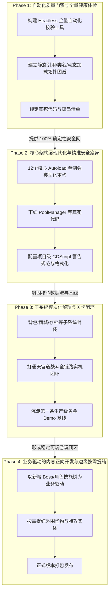

# ZMXYBHYH 现代化重构与工程演进路线图 (Roadmap)

本文档定义了 **ZMXYBHYH（《造梦西游八荒》/《八荒湮隳》）** 从逆向提纯工程迈向现代化独立游戏工程的完整演进规划。

路线图遵循 **“保持时刻可运行、零错误零警告门禁、由核到翼、小步快跑”** 的核心工程原则，将开发任务清晰解耦为四大有序阶段。

---

## 阶段演进全景图

---

## 现状底数概览（当前基线）

| 统计指标 | 真实数据 | 架构含义与现状 |
|:---|:---|:---|
| **GDScript 脚本规模** | **874 个** | 累计代码量 **188,983 行** |
| **Scene 场景规模** | **1,242 个** | 累计场景描述 **500,543 行** |
| **核心 Autoload 单例** | **12 个** | 承担全游戏约 40% 的高频状态调度（`Global`, `PlayerData`, `RoleProp`, `AE` 等） |
| **有明确静态引用脚本** | **788 个（90.1%）** | 被场景树或代码直接 `preload` / `load` 引用 |
| **孤岛候选脚本** | **86 个（9.9%）** | 混杂了“真死代码”（如 `PoolManager`）与“暗中调用的假孤岛”（如 `MagicWeapon` 仍被 157 个文件调用） |
| **运行时健康状态** | **0 ERROR, 0 WARNING** | 主菜单与背包初始化已达成绝对纯净 |

---

## Phase 1: 自动化质量门禁与全量健康体检 (Safety Net & Health Audit)

### 1.1 阶段定位与目标
- **定位**：构筑不可逾越的自动化安全网，为后续代码重构提供 100% 确定性的证据链。
- **核心目标**：在不改动任何业务逻辑的前提下，实现一键 5 秒内全量扫描 874 个脚本与 1,242 个场景的引用健康状态；彻底分清哪些是真死代码，哪些是动态调用的假孤岛，杜绝重构中的“误杀”。

### 1.2 计划内容
1. **编写全工程自动化体检工具链**（`tools/health_check.py`）：
   - 基于 Godot 4.7.2 Headless 模式与静态 AST 分析，能够脱离 GUI 快速预编译并检查全量脚本；
   - 检查所有场景的 `ext_resource` 路径有效性，捕获潜在悬空引用；
2. **构建全量符号与依赖逆向拓扑矩阵**：
   - 全面提取 `class_name` 注册清单及其全局继承树；
   - 深度扫描代码中以字符串形式动态拼装的 `load("res://...")` / `preload(...)` / `has_method()` 模式；
3. **输出《死代码与孤岛资产确凿审计清单》**：
   - 逐一交叉对比 86 个孤岛候选，明确分类为：
     - **纯废弃死代码**：全局 0 引用、无动态命中，确认可安全移除；
     - **隐式活跃代码**：因 Flash 遗留机制或动态反射调用的活代码，严加保护并记录调用源。

### 1.3 执行边界与红线
- ⚠️ **只读审计原则**：本阶段**严禁删除或修改任何业务脚本与场景文件**；
- ⚠️ **工具链隔离**：所有脚本必须保存在 `tools/` 目录下，严禁污染 `source/v6.5.0.0/` 的游戏运行环境；
- ⚠️ **零干扰**：体检工具必须保证幂等性与纯内存检查，不得残留任何临时垃圾文件。

### 1.4 验收内容与指标
1. `tools/health_check.py` 能够在 **5 秒内** 完成全工程静态与无头编译健康扫描，并输出结构化检查报告；
2. 产出明确的死代码与假孤岛分类报告，作为 Phase 2 安全瘦身的唯一依据；
3. 全工程运行时继续保持 **0 错误、0 警告**。

---

## Phase 2: 核心架构层现代化与精准安全瘦身 (Core Architecture & Type Safety)

### 1.1 阶段定位与目标
- **定位**：重构游戏的核心中枢系统，确立现代代码规范，下线明确无害的历史死代码。
- **核心目标**：全面治理 12 个核心 Autoload 单例，开启 GDScript 2.0 现代静态类型提示；安全剥离纯死代码，建立项目级静态规则守卫。

### 1.2 计划内容
1. **12 个核心 Autoload 全局单例强类型重构**：
   - 对 `Global.gd`、`PlayerData.gd`、`RoleProp`（`BaseRoleProperies.gd`）、`AllEquipment.gd` 等核心单例全面引入静态类型标注（`var level: int = 1`，函数显式声明返回值类型 `-> void`）；
   - 梳理并收敛散乱的全局字典字段，减少拼写错误带来的隐式 Bug；
2. **数据持久化契约正位**：
   - 规范 `PlayerData.gd` 与 `MemoryClass.gd` 的存档加解密与读写流程，消除冗余的磁盘同步开销；
3. **精准清理核准的纯死代码**：
   - 依据 Phase 1 的证据清单，安全下线确认 0 引用的废弃文件（如 `PoolManager.gd`、`OtherBuff.gd` 等），从根源减少工程负担；
4. **引入项目级 GDScript 警告规范**：
   - 在 `project.godot` 中按梯度开启核心静态检查警告（如未初始化变量 `UNASSIGNED_VARIABLE`、未匹配信号、返回值遗弃等）；
   - 统一代码缩进与排版风格。

### 1.3 执行边界与红线
- ⚠️ **单点突破原则**：每次仅重构一个核心单例或清理一个确认文件，严禁多模块大面积并行修改；
- ⚠️ **向后兼容契约**：必须保持对外公开 API 签名与调用语义兼容，不得导致既有场景抛出 `Identifier not found`；
- ⚠️ **每步即门禁**：每改动一个单例，必须立即运行 Phase 1 自动化体检工具与实机冒烟，确认 0 错误后方可提交。

### 1.4 验收内容与指标
1. 核心 Autoload 单例的静态类型提示覆盖率达到 **90% 以上**；
2. 确认的无风险死代码安全移除，未引入任何破坏性引用断裂；
3. Godot 4.7.2 编辑器与实机启动日志严格维持 **0 错误、0 警告**。

---

## Phase 3: 子系统模块化解耦与关卡闭环 (Subsystem Modularization & Gameplay Loop)

### 1.1 阶段定位与目标
- **定位**：收敛垂直业务系统，打通第一条从选人到关卡战斗结算的黄金游玩闭环。
- **核心目标**：摆脱历史脚本各自为政的状态，让背包、商城、关卡加载完成模块化封闭；打通第一关“天宫道”全程无报错的完整战斗体验。

### 1.2 计划内容
1. **独立子系统正位封装**：
   - **背包与装备系统**：深化已实施的“三层守卫”机制，标准化穿脱装备、道具强化、宝石镶嵌的信号响应；
   - **场景加载管线**：优化 `load_scene.tscn` 到各关卡的过渡流程，杜绝加载过程中的微卡顿与黑屏；
2. **第一关“天宫道”（`HDZM.tscn` / `Level_1.gd`）完整闭环打通**：
   - 验证孙悟空、猪八戒等核心主角的角色进场与操作手感；
   - 梳理前置小怪（蝙蝠、小妖等）的巡逻与攻击 AI；
   - 校验第一关守关 Boss（邪四天王）的技能流转、弹幕发射与受击判定；
   - 验证通关掉落、经验结算与存档写入全链路。

### 1.3 执行边界与红线
- ⚠️ **业务聚焦原则**：范围严格锁定在天宫道关卡及其强依赖的实体子集，严禁无故触碰其他后续未开放关卡；
- ⚠️ **数值与手感保真**：严禁擅自改动经典 Flash 时代的动作帧率、跳跃重力与伤害计算数值手感。

### 1.4 验收内容与指标
1. 从游戏启动、主菜单选人、进入天宫道关卡、战斗清怪、击败 Boss 直至结算返回，全流程 **100% 流畅运行**；
2. 整场战斗过程中，`logs/godot.log` 日志输出全程保持 **0 ERROR、0 WARNING**；
3. 形成具备高度可玩性的“垂直切片（Vertical Slice Demo）”基线版本。

---

## Phase 4: 业务驱动的内容正向开发与边缘按需提纯 (Content Evolution & On-Demand Refactoring)

### 1.1 阶段定位与目标
- **定位**：由“防御性重构”正式跨入“正向创新”，以业务需求牵引边缘代码现代化。
- **核心目标**：开始设计全新的游戏特性与玩法，并采用“按需重构”模式逐步消化外围怪物与技能资产。

### 1.2 计划内容
1. **正向内容开发**：
   - 新增原创/重制 Boss、高级觉醒技能与全新神兵法宝系统；
   - 拓展后续关卡（如九龙岛、龙脊山、兜率宫等）；
2. **外围实体按需提纯 (On-Demand Refactoring)**：
   - 遵循“谁消费谁重构”原则：做新关卡或新机制调用到老旧怪兽脚本（`Monster_*.gd`）时，顺手将其提纯为标准组件化结构，避免全面铺开的无效重写；
3. **发行准备与打包流水线**：
   - 配置标准化 Windows x64 发行导出模板，建立自动化打包脚本。

### 1.3 执行边界与红线
- ⚠️ **严守 YAGNI 原则**：未被当前关卡或玩法消费的外围实体代码保持原样，不为假想的重构承担额外成本；
- ⚠️ **代码规范守恒**：所有新增业务代码必须从第一天起严格遵循 GDScript 2.0 强类型与三层守卫规范。

### 1.4 验收内容与指标
1. 新增功能独立完备，游戏整体可玩性与内容丰富度显著提升；
2. 全流程保持生产级稳定性，达成发布级质量标准。
